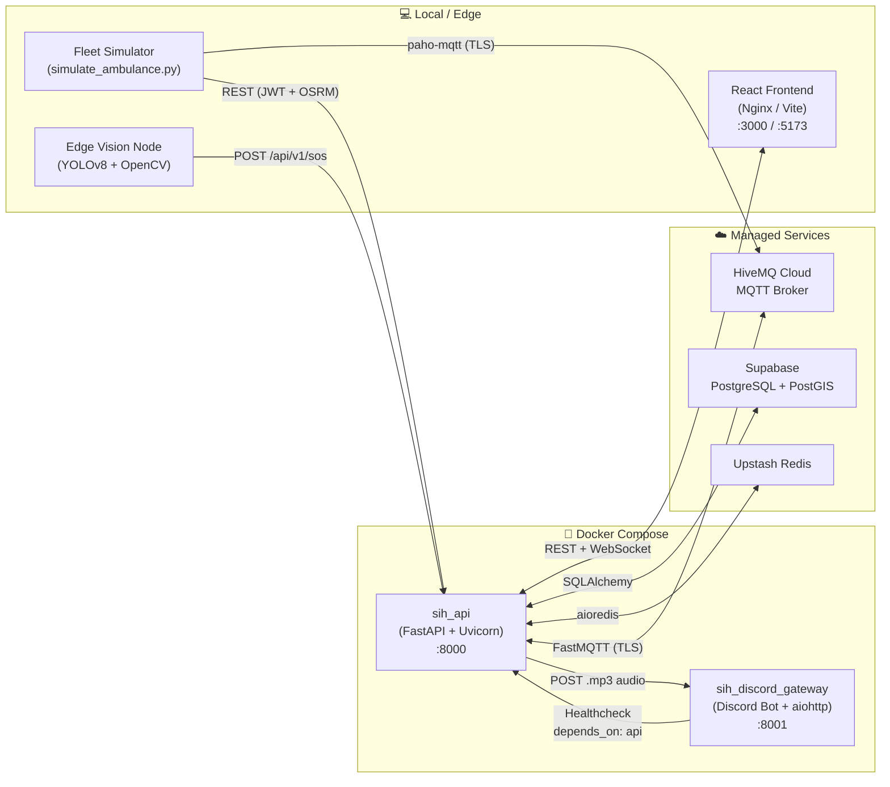
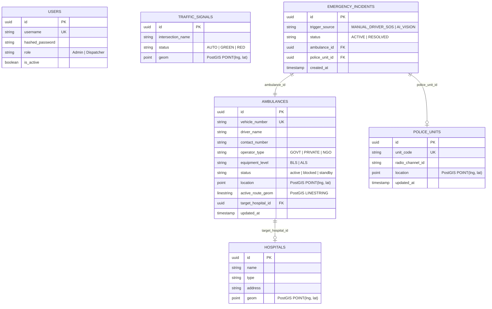

# 🏗️ EROS — System Architecture

> **Emergency Response & Operational System**
> Decoupled, Event-Driven IoT Architecture for Intelligent Ambulance Priority & Traffic De-Congestion

---

## High-Level Architecture Diagram

```mermaid
flowchart TD

    %% ════════════════════════════════════════════════════════════════════════
    %% STYLING
    %% ════════════════════════════════════════════════════════════════════════
    classDef client fill:#1e3a5f,stroke:#4fc3f7,stroke-width:2px,color:#e1f5fe
    classDef edge fill:#4a148c,stroke:#ce93d8,stroke-width:2px,color:#f3e5f5
    classDef api fill:#1b5e20,stroke:#81c784,stroke-width:2px,color:#e8f5e9
    classDef mqtt fill:#e65100,stroke:#ffb74d,stroke-width:2px,color:#fff3e0
    classDef db fill:#b71c1c,stroke:#ef9a9a,stroke-width:2px,color:#ffebee
    classDef alert fill:#880e4f,stroke:#f48fb1,stroke-width:2px,color:#fce4ec
    classDef ext fill:#37474f,stroke:#90a4ae,stroke-width:2px,color:#eceff1

    %% ════════════════════════════════════════════════════════════════════════
    %% CLIENT LAYER
    %% ════════════════════════════════════════════════════════════════════════
    subgraph CLIENTS["🖥️ Client Layer"]
        direction LR
        CC["Command Center\n(React + Mapbox GL JS)\nNginx / :3000"]
        DA["Driver App\n(Mobile PWA)"]
        DISP["Dispatcher Console\n(React Dashboard)"]
    end
    class CC,DA,DISP client

    %% ════════════════════════════════════════════════════════════════════════
    %% EDGE / IoT HARDWARE LAYER
    %% ════════════════════════════════════════════════════════════════════════
    subgraph EDGE["🔌 Edge / IoT Hardware Layer"]
        direction LR
        SIM["Fleet Simulator\n12 Ambulances\n(simulate_ambulance.py)"]
        VISION["Video ML Node\n(YOLOv8 — Obstruction\nDetection)"]
        AUDIO["Audio ML Node\n(Siren Classifier)"]
    end
    class SIM,VISION,AUDIO edge

    %% ════════════════════════════════════════════════════════════════════════
    %% THIRD-PARTY SERVICES
    %% ════════════════════════════════════════════════════════════════════════
    subgraph THIRDPARTY["🌐 Third-Party Services"]
        direction LR
        OSRM["OSRM Routing API\n(Route Geometry)"]
        MAPBOX["Mapbox GL JS\n(Map Tiles + Rendering)"]
        GTTS["Google TTS API\n(Voice Synthesis)"]
    end
    class OSRM,MAPBOX,GTTS ext

    %% ════════════════════════════════════════════════════════════════════════
    %% CLOUD BACKEND
    %% ════════════════════════════════════════════════════════════════════════
    subgraph BACKEND["☁️ Cloud Backend (FastAPI / Uvicorn :8000)"]
        direction TB

        subgraph AUTH_LAYER["🔐 Auth Module"]
            AUTH["JWT Auth\n(HS256 + bcrypt)\n/api/v1/auth/*"]
        end

        subgraph REST_LAYER["📡 REST API Layer"]
            direction LR
            MAP_API["World State API\n/map/ambulances\n/map/police"]
            HOSP_API["Hospital API\n/hospitals"]
            TRAFFIC_API["Traffic Signal API\n/traffic-signals"]
            AMB_API["Ambulance CRUD\n/ambulances/*"]
            EMRG_API["Emergency API\n/sos, /incidents"]
            ROUTE_API["Routing API\n/route"]
            CORRIDOR_API["Corridor API\n/corridor/status"]
        end

        subgraph REALTIME_LAYER["⚡ Real-Time Layer"]
            direction LR
            WS_MGR["WebSocket Manager\n/ws/telemetry\n(ConnectionManager)"]
            MQTT_HANDLER["MQTT Handler\n(on_message dispatcher)"]
        end

        subgraph BRAIN["🧠 Preemption Brain"]
            direction TB
            SPATIAL["Spatial Engine\n120° FOV + 500m Radius\nEdge-Triggered State"]
            FLUSH["Write-Behind Flusher\n(Redis → PostGIS\nevery 5 seconds)"]
            REROUTE["Auto-Rerouter\n(ST_Distance deviation\n> 50m triggers recalc)"]
        end

        subgraph DISPATCH["📢 Alert Dispatch"]
            direction LR
            TTS_SVC["RoIP Service\n(gTTS → .mp3 synthesis)"]
            POLICE_TRIG["Police Trigger\nMQTT Publish\nsih/police/trigger/+"]
        end
    end
    class AUTH,MAP_API,HOSP_API,TRAFFIC_API,AMB_API,EMRG_API,ROUTE_API,CORRIDOR_API api
    class WS_MGR,MQTT_HANDLER api
    class SPATIAL,FLUSH,REROUTE api
    class TTS_SVC,POLICE_TRIG api

    %% ════════════════════════════════════════════════════════════════════════
    %% EVENT / IoT LAYER (MANAGED SERVICES)
    %% ════════════════════════════════════════════════════════════════════════
    subgraph EVENT_LAYER["📨 Event / IoT Broker Layer"]
        direction LR
        HIVEMQ["HiveMQ Cloud\nMQTT Broker\n(TLS :8883)"]
        REDIS["Upstash Redis\n(Telemetry Buffer\n+ Cooldown Locks)"]
    end
    class HIVEMQ,REDIS mqtt

    %% ════════════════════════════════════════════════════════════════════════
    %% DATA STORAGE LAYER
    %% ════════════════════════════════════════════════════════════════════════
    subgraph DATA["🗄️ Data Storage Layer"]
        direction LR
        PG["PostgreSQL + PostGIS\n(Supabase)\nAmbulances, Hospitals,\nIntersections, Police,\nUsers, Routes"]
    end
    class PG db

    %% ════════════════════════════════════════════════════════════════════════
    %% ALERTING GATEWAY LAYER
    %% ════════════════════════════════════════════════════════════════════════
    subgraph ALERT_LAYER["🔊 Alerting / RoIP Gateway Layer"]
        direction LR
        DISCORD_BOT["Discord Voice Bot\n(aiohttp :8001)\nMock RoIP Gateway"]
        DISCORD_VC["Discord Voice Channel\n(FFmpeg Audio Playback)"]
        WEBHOOK["Discord Webhook\n(Text Alerts)"]
    end
    class DISCORD_BOT,DISCORD_VC,WEBHOOK alert

    %% ════════════════════════════════════════════════════════════════════════
    %% DATA FLOW ARROWS
    %% ════════════════════════════════════════════════════════════════════════

    %% ── Auth Pipeline ─────────────────────────────────────────────────────
    SIM -->|"1. POST /auth/login\n(Get JWT)"| AUTH
    CC -->|"1. POST /auth/login\n(Get JWT)"| AUTH

    %% ── World State Sync ──────────────────────────────────────────────────
    CC -->|"2. GET /map/ambulances\nGET /map/police\n(Initial World State)"| MAP_API
    CC -->|"GET /hospitals\nGET /traffic-signals"| HOSP_API
    DA -->|"GET /corridor/status"| CORRIDOR_API

    %% ── Simulator → OSRM → MQTT ──────────────────────────────────────────
    SIM -->|"3. GET /route/v1/driving\n(Fetch OSRM GeoJSON)"| OSRM
    SIM -->|"4. PUB sih/ambulance/telemetry/+\n(lat, lng, speed, status)"| HIVEMQ
    SIM -->|"4. PUB sih/ambulance/route/+\n(OSRM GeoJSON LineString)"| HIVEMQ

    %% ── MQTT → Backend Pipeline ──────────────────────────────────────────
    HIVEMQ -->|"5. SUB sih/ambulance/telemetry/+\nSUB sih/ambulance/route/+"| MQTT_HANDLER

    %% ── Telemetry Processing ──────────────────────────────────────────────
    MQTT_HANDLER -->|"6a. HSET telemetry_buffer\n(Write-Behind Cache)"| REDIS
    MQTT_HANDLER -->|"6b. Broadcast JSON\n(Real-Time)"| WS_MGR
    MQTT_HANDLER -->|"6c. Evaluate 120° FOV\n+ 500m Radius"| SPATIAL

    %% ── WebSocket → Frontend ─────────────────────────────────────────────
    WS_MGR -->|"7. ws://host/ws/telemetry\n(Push lat/lng + Signal Overrides)"| CC

    %% ── Preemption Brain ──────────────────────────────────────────────────
    SPATIAL -->|"8a. PUB sih/traffic/signals/+/override\n(GREEN / NORMAL)"| HIVEMQ
    SPATIAL -->|"8b. Broadcast\nSIGNAL_OVERRIDE event"| WS_MGR
    SPATIAL -->|"8c. fire_tts()\n(Thread Pool)"| TTS_SVC

    %% ── Write-Behind Flush ────────────────────────────────────────────────
    REDIS -->|"9. HGETALL + DELETE\n(Every 5 seconds)"| FLUSH
    FLUSH -->|"10. Batch UPSERT\n(location, status, updated_at)"| PG
    FLUSH -->|"10a. ST_Distance deviation\n> 50m?"| REROUTE
    REROUTE -->|"10b. Recalculate route\nvia OSRM"| OSRM

    %% ── Blocked Ambulance → Police ───────────────────────────────────────
    FLUSH -->|"11. If status=blocked\nfind_nearest_police_unit()"| PG
    FLUSH -->|"11a. PUB sih/police/trigger/+\n(Flash Alert)"| POLICE_TRIG
    POLICE_TRIG --> HIVEMQ

    %% ── TTS → Discord RoIP Gateway ──────────────────────────────────────
    TTS_SVC -->|"12a. Synthesize .mp3"| GTTS
    TTS_SVC -->|"12b. POST /api/v1/emergency/\nmock-roip-gateway\n(Audio Bytes)"| DISCORD_BOT
    TTS_SVC -->|"12c. POST Webhook\n(Text Alert)"| WEBHOOK
    DISCORD_BOT -->|"13. FFmpegPCMAudio\nPlayback"| DISCORD_VC

    %% ── ML Failsafe Pipelines ────────────────────────────────────────────
    VISION -->|"ML-1. POST /api/v1/sos\n(Video Anomaly — Blocked)"| EMRG_API
    AUDIO -->|"ML-2. PUB sih/ambulance/telemetry/+\n(Siren Detected → status=blocked)"| HIVEMQ
    EMRG_API -->|"ML-1a. Save Incident"| PG
    EMRG_API -->|"ML-1b. Trigger RoIP"| TTS_SVC

    %% ── Map Tiles ─────────────────────────────────────────────────────────
    CC -->|"Map Tiles + Satellite"| MAPBOX

    %% ── REST → Database ───────────────────────────────────────────────────
    MAP_API --> PG
    HOSP_API --> PG
    TRAFFIC_API --> PG
    AMB_API --> PG
    ROUTE_API --> PG
```



---

## Key Data Pipelines

### 1. 🔐 Authentication Pipeline

| Step | Component | Action |
|------|-----------|--------|
| 1 | Simulator / Frontend | `POST /api/v1/auth/login` with `username` + `password` (form-encoded) |
| 2 | FastAPI Auth Router | Validates credentials against bcrypt hash in PostgreSQL |
| 3 | JWT Module | Issues HS256 signed `access_token` (30-min TTL) |
| 4 | Caller | Stores token, includes `Authorization: Bearer <token>` on all subsequent requests |

### 2. 🗺️ World State Sync Pipeline

| Step | Component | Action |
|------|-----------|--------|
| 1 | React Command Center | `GET /api/v1/map/ambulances` → GeoJSON FeatureCollection (PostGIS `ST_AsGeoJSON`) |
| 2 | React Command Center | `GET /api/v1/hospitals` → GeoJSON FeatureCollection |
| 3 | React Command Center | `GET /api/v1/traffic-signals` → GeoJSON FeatureCollection |
| 4 | Mapbox GL JS | Renders markers, routes, and signal overlays on the live map |

### 3. 📡 Telemetry Stream Pipeline (Hot Path — 2-second intervals)

```
Simulator                    HiveMQ              Backend MQTT Handler
    │                          │                          │
    │  PUB telemetry/{id}      │                          │
    │  {lat, lng, speed,       │   SUB telemetry/+        │
    │   status}  ─────────────►│─────────────────────────►│
    │                          │                          │
    │                          │              ┌───────────┤
    │                          │              │           │
    │                          │         ┌────▼────┐ ┌────▼────┐
    │                          │         │  Redis  │ │   WS    │
    │                          │         │ HSET    │ │Broadcast│
    │                          │         │ buffer  │ │ to Map  │
    │                          │         └────┬────┘ └─────────┘
    │                          │              │ (every 5s)
    │                          │         ┌────▼─────────┐
    │                          │         │  PostgreSQL   │
    │                          │         │  Batch UPSERT │
    │                          │         └───────────────┘
```

### 4. ⚡ Fast-Path Preemption Pipeline (The Brain)

This is the core intelligence of EROS — the **Edge-Triggered, Directional Traffic Preemption** engine.

| Step | Logic | Detail |
|------|-------|--------|
| 1 | **Heading Calculation** | Compares current GPS with `PREVIOUS_LOCATIONS[ambulance_id]` to derive vehicle heading (bearing in degrees) |
| 2 | **Spatial Scan** | Iterates over `CACHED_SIGNALS` (loaded once from PostGIS at MQTT connect). For each signal, computes Haversine distance |
| 3 | **FOV Check** | Only signals within **500m** AND within a **120° forward cone** (±60° from heading) are considered. This prevents triggering signals behind the vehicle |
| 4 | **Edge Trigger** | `ACTIVE_OVERRIDES` set ensures each signal fires **only once per approach**. 15-second cooldown prevents re-trigger oscillation |
| 5 | **On Entry** | Publishes `GREEN` override to `sih/traffic/signals/{id}/override` via MQTT + broadcasts `SIGNAL_OVERRIDE` event to all WebSocket clients |
| 6 | **TTS Dispatch** | Spawns a thread-pool worker that queries the ambulance's driver/vehicle metadata from DB, synthesizes a voice alert via gTTS, and POSTs the `.mp3` audio to the Discord RoIP Gateway |
| 7 | **On Exit** | When ambulance leaves the 500m zone, publishes `NORMAL` override and removes from `ACTIVE_OVERRIDES` |

### 5. 🚨 Blocked Ambulance → Police Alert Pipeline

| Step | Component | Action |
|------|-----------|--------|
| 1 | Write-Behind Flusher | Detects `status == "blocked"` during the 5-second batch flush |
| 2 | `geospatial.py` | Runs `ST_Distance` with `::geography` cast to find nearest `PoliceUnit` in metres |
| 3 | MQTT Publisher | Publishes `{"flash": true, "ambulance_id": "..."}` to `sih/police/trigger/{police_id}` |
| 4 | Emergency Router | Creates an `EmergencyIncident` record in PostgreSQL |
| 5 | RoIP Service | Synthesizes TTS audio and dispatches to Discord Voice Gateway |

### 6. 🤖 ML Failsafe Pipelines

#### Video ML Node (Obstruction Detection)
```
Camera Feed → YOLOv8 Inference → Anomaly Detected?
    │                                      │
    │                              YES ─────┤
    │                                       ▼
    │                         POST /api/v1/sos
    │                         (trigger_source: "AI_VISION")
    │                                       │
    │                               ┌───────▼───────┐
    │                               │ Save Incident  │
    │                               │ to PostgreSQL  │
    │                               └───────┬───────┘
    │                                       │
    │                               ┌───────▼───────┐
    │                               │  RoIP TTS     │
    │                               │  Dispatch     │
    │                               └───────────────┘
```

#### Audio ML Node (Siren Classification)
```
Microphone Feed → Siren Classifier → Siren Detected?
    │                                        │
    │                                YES ────┤
    │                                        ▼
    │                   PUB sih/ambulance/telemetry/{id}
    │                   {status: "blocked"}
    │                          │
    │                  (Enters standard telemetry pipeline)
```

### 7. 🔄 Auto-Rerouting Pipeline

| Step | Component | Action |
|------|-----------|--------|
| 1 | Write-Behind Flusher | After upserting location, calculates `ST_Distance` between ambulance point and its `active_route_geom` LineString |
| 2 | Deviation Check | If distance > **50 metres**, the ambulance has deviated from its planned route |
| 3 | OSRM Recalculation | Fetches a new route from current position to `target_hospital_id` via OSRM Directions API |
| 4 | Route Update | Updates `active_route_geom` in PostgreSQL and broadcasts the new geometry to the frontend |

---

## Deployment Topology



---

## MQTT Topic Map

| Topic Pattern | Publisher | Subscriber | QoS | Payload |
|---------------|----------|------------|-----|---------|
| `sih/ambulance/telemetry/{id}` | Simulator / IoT Device | Backend `_handle_telemetry` | 1 | `{status, lat, lng, speed}` |
| `sih/ambulance/route/{id}` | Simulator | Backend `_handle_route_update` | 1 | GeoJSON `{type: "LineString", coordinates: [...]}` |
| `sih/traffic/signals/{id}/override` | Backend (Preemption Brain) | Hardware / Frontend | 1 | `{status: "GREEN"/"NORMAL", ambulance_id}` |
| `sih/police/trigger/{id}` | Backend (Police Alert) | Police Unit Hardware | 1 | `{flash: true, ambulance_id}` |
| `sih/roip/channel/{id}/broadcast` | Backend (TTS Service) | RoIP Hardware | 1 | `{action: "play_tts", text, priority}` |

---

## Database Entity Map



---

## Technology Stack Summary

| Layer | Technology | Purpose |
|-------|-----------|---------|
| **Frontend** | React 18, Mapbox GL JS, Vite | Command Center Dashboard |
| **API Server** | FastAPI 0.115, Uvicorn, Python 3.13 | REST + WebSocket Gateway |
| **Auth** | PyJWT (HS256), passlib + bcrypt | Stateless JWT Authentication |
| **MQTT Broker** | HiveMQ Cloud (TLS :8883) | IoT Telemetry Transport |
| **Realtime Cache** | Upstash Redis (aioredis) | Write-Behind Buffer + Cooldowns |
| **Database** | PostgreSQL + PostGIS (Supabase) | Geospatial Data Storage |
| **ORM** | SQLAlchemy 2.0, GeoAlchemy2 | Database Abstraction |
| **TTS Engine** | Google TTS (gTTS) | Voice Alert Synthesis |
| **RoIP Gateway** | Discord.py + aiohttp | Mock Radio-over-IP Playback |
| **ML Vision** | YOLOv8 (Ultralytics) + OpenCV | Obstruction Detection |
| **Routing** | OSRM (public API) | Turn-by-turn Route Geometry |
| **Containerisation** | Docker, Docker Compose | Multi-service Orchestration |
